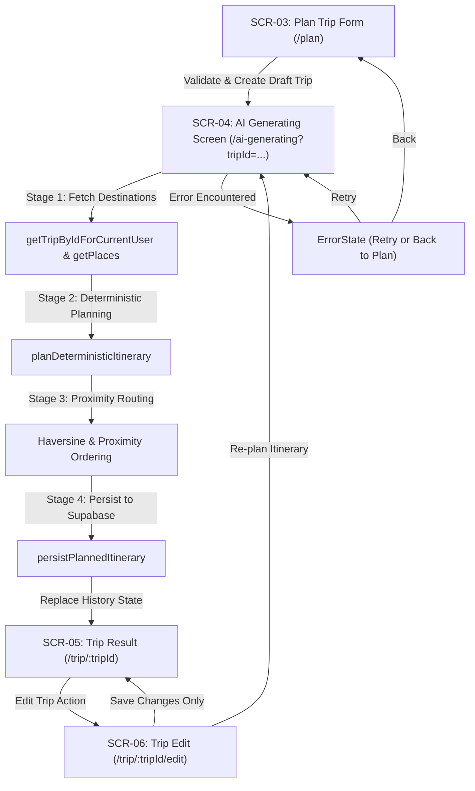

# HUEGO — Phase 6.2C Completion Report: UI and Service Integration

**Date**: 2026-10-17  
**Status**: Completed & Verified  
**Target Objective**: Connect the existing Plan Trip → AI Generating → Trip Result flow to the deterministic itinerary planner and Supabase persistence without redesigning screens, without integrating an external LLM, and without modifying database schemas.

---

## 1. Executive Summary

Phase 6.2C integrates the user-facing trip planning screens with the validated deterministic planning engine and Supabase persistence layer.

The complete primary flow (`PlanTrip` → `AIGenerating` → `TripResult` → `TripEdit/Re-plan`) is now operational:
1. **Plan Trip** (`PlanTripPage.tsx`): Form input validation prevents invalid durations, negative budgets, or invalid traveler counts. Duplicate submission prevention disables the submit button during submission. Creates a draft trip record in Supabase and routes to `/ai-generating?tripId={id}`.
2. **AI Generating** (`AIGeneratingPage.tsx`): Functions as a truthful, progress-driven loading screen (fetching destinations, calculating scores, optimizing routes, and persisting the itinerary) without implying an external LLM is running. Features unmount cancellation guards, authentication verification, and comprehensive error recovery paths ("Try again" and "Back to Plan Trip").
3. **Trip Result** (`TripResultPage.tsx`): Displays the persisted multi-day itinerary directly from Supabase via `useTrip`, showing chronological time slots, place names linked to Place Detail (`/place/{placeId}`), transit durations, distances, ticket fees, and day summaries.
4. **Trip Edit / Re-plan** (`TripEditPage.tsx`): Supports both saving metadata changes and re-triggering the planning pipeline via a dedicated "Re-plan itinerary" action.

All verification steps passed, including 28 deterministic planner unit tests, 10 automated database integration tests, clean ESLint validation (0 errors, 0 warnings), and Vite production builds.

---

## 2. Modified Files and Rationale

| File Path | Status | Rationale |
|---|---|---|
| `src/pages/PlanTrip/PlanTripPage.tsx` | **Modified** | Added input validation (duration $\ge 1$ and $\le 30$, travelers $\ge 1$, non-negative budget); added submission lockout (`disabled={submitting}`); creates `draft` trip in Supabase and navigates to `/ai-generating?tripId=${trip.id}`. |
| `src/pages/AIGenerating/AIGeneratingPage.tsx` | **Modified** | Transformed static placeholder into an active, resilient planning controller. Orchestrates destination retrieval, deterministic planning, and Supabase persistence across 4 visual stages; safely handles unmounting, missing trip IDs, auth checks, and errors. |
| `src/pages/TripResult/TripResultPage.tsx` | **Modified** | Enhanced itinerary card rendering to display complete activity details (place title linked to `SCR-08`, formatted time ranges, transit metrics, entrance fees, and notes); added "Plan Another Trip" button. |
| `src/pages/TripEdit/TripEditPage.tsx` | **Modified** | Added `handleReplan` and "Re-plan itinerary" button to route back through `AIGenerating` with updated trip parameters, satisfying `SCR-06 → SCR-04 → SCR-05`. |
| `docs/PHASE_6_2C_COMPLETION_REPORT.md` | **Created** | Comprehensive technical and compliance documentation for Phase 6.2C. |

---

## 3. Flow Details & User Experience



### Flow Walkthrough

1. **Plan Trip Form Submission**:
   - User inputs title, duration (days), budget, travelers, companion type, transportation, and special constraints.
   - Validation checks run before network requests. Invalid fields stop submission and display inline errors.
   - On valid submit, `createTrip` creates a `draft` trip row in Supabase.
   - Navigates to `/ai-generating?tripId={trip.id}` passing `tripId` via URL query param and route state.

2. **Generating Screen Execution**:
   - Step 1: Fetches trip configuration and all active Huế destinations (`is_active = true`).
   - Step 2: Runs `planDeterministicItinerary` using trip parameters and active places.
   - Step 3: Optimizes intra-day routes using nearest-neighbor Haversine chaining.
   - Step 4: Calls `persistPlannedItinerary`, writing `trip_days` and `trip_activities` to Supabase, then marks trip status as `planned`.
   - On success: Calls `navigate('/trip/' + trip.id, { replace: true })` so back-navigation returns to the planner rather than trapping the user in the loading screen.

3. **Trip Result Screen**:
   - Fetches trip, days, activities, and places through `useTrip(tripId)`.
   - Renders each day with summary metrics (distance, travel time, admission fees).
   - Renders each activity with place name (clickable link to `/place/:placeId`), start/end times, transit duration, distance, admission fee, and description.

4. **Trip Edit & Re-plan**:
   - From `/trip/:tripId/edit`, user can adjust title, duration, budget, companion, and transportation.
   - Clicking "Save changes" updates metadata and returns to `/trip/:tripId`.
   - Clicking "Re-plan itinerary" updates the trip to `draft` and routes back to `/ai-generating?tripId={tripId}`, recreating days and activities with the new parameters.

---

## 4. Database Behavior & Persistence Alignment

All database writes adhere to the schema constraints confirmed during the Phase 6.2A and 6.2B audits:

1. **`trips` Table**:
   - Created with `status: 'draft'`, then updated to `status: 'planned'` upon successful itinerary persistence.
   - NOT NULL constraints satisfied (`days_count`, `user_id`).
   - Tenant isolation enforced via RLS (`auth.uid() = user_id`).
2. **`trip_days` Table**:
   - Cleaned up before new days are inserted to prevent `(trip_id, day_number)` unique constraint violations (`trip_days_trip_id_day_number_key`).
   - All required fields provided (`trip_id`, `day_number`).
3. **`trip_activities` Table**:
   - All required fields provided (`trip_day_id`, `title`, `activity_type`, `order_index`).
   - Foreign key `place_id` references real place IDs from `places`.
   - `is_ai_generated` is explicitly set to `false` to reflect deterministic rule-based generation.
   - Foreign key cascade `ON DELETE CASCADE` ensures deleting days cleanly removes associated activities.

---

## 5. Error Handling Matrix

| Error Scenario | Detection Point | Handling & UI Behavior |
|---|---|---|
| **Not Authenticated** | `ProtectedRoute` & `AIGeneratingPage` | `ProtectedRoute` redirects to `/auth?redirect=...`. If session expires on generating screen, renders `ErrorState` with "Sign In" button. |
| **Invalid Form Input** | `PlanTripPage.handleSubmit` | Rejects non-positive or float days, days $> 30$, travelers $< 1$, or negative budget. Sets error message without sending network requests. |
| **Duplicate Clicks** | `PlanTripPage` & `AIGeneratingPage` | Submit button set to `disabled={submitting}`; submit handler checks `if (submitting) return`. Generating screen uses `inProgressRef` to block duplicate execution. |
| **Missing Trip ID** | `AIGeneratingPage` mount | If `tripId` is null/empty, renders `ErrorState` ("Missing Trip ID") with button linking to `/plan`. Prevents navigation to invalid URLs. |
| **Trip Inaccessible / 404** | `AIGeneratingPage.runPlanner` | If `getTripByIdForCurrentUser` returns null (due to RLS or nonexistent ID), displays `ErrorState` with "Back to Plan Trip" button. |
| **No Active Places** | `AIGeneratingPage.runPlanner` | If `places.length === 0`, displays `ErrorState` ("No Destinations Available") with retry and back options. |
| **Planner / Capacity Error** | `planDeterministicItinerary` | If planner returns `{ success: false }`, displays specific failure reason with retry and back options. |
| **Supabase Read/Write Failure** | `persistPlannedItinerary` | Catches error, triggers compensation cleanup of any partially created days, and renders `ErrorState` with "Try again" button. |
| **User Navigating Away** | `AIGeneratingPage` unmount | `useEffect` cleanup sets `isSubscribed = false`. Prevents `setState` or `navigate` calls after unmount, leaving user navigation undisturbed. |
| **Page Refresh on Result** | `TripResultPage` | Independent `useTrip` hook queries Supabase directly. Result rendering has zero dependence on in-memory state. |

---

## 6. Test and Verification Results

### A. Automated Integration & Persistence Suite (Passed)
Command: `npx tsx scratch/test_phase_6_2c_integration.ts`
- **Test 1: Form Validation Logic**: Verified rejection of non-integer, negative, $> 30$, or zero days/travelers; verified budget parsing.
- **Test 2: Authentication**: Authenticated test user via Supabase Auth API.
- **Test 3: Plan Trip Draft Persistence**: Created draft trip with metadata (`status = 'draft'`).
- **Test 4: Fetch Active Destinations**: Fetched all 12 active destinations; verified `is_verified = false`.
- **Test 5: Deterministic Planning**: Produced balanced 2-day itinerary with realistic travel times and fees.
- **Test 6: Supabase Persistence**: Persisted 2 `trip_days` and 6 `trip_activities`; verified all required columns and `is_ai_generated: false`.
- **Test 7: Record Verification**: Read back all rows and confirmed valid foreign keys and non-null titles.
- **Test 8: Page Refresh Simulation**: Reloaded trip purely from database queries; confirmed zero reliance on in-memory state.
- **Test 9: Re-plan Flow**: Re-planned and updated trip to 3 days cleanly without unique constraint conflicts.
- **Test 10: Regression Check**: Verified `place_categories`, `place_images`, and `places` queries remain fully functional.
- **Cleanup**: Deleted test trip cleanly (cascading deleted days and activities).

### B. Deterministic Planner Unit Tests (Passed)
Command: `npx tsx scratch/test_deterministic_planner.ts`
- **28 / 28 tests passed** (empty data, inactive filtering, fallbacks for null fields, budget warnings, proximity ordering, byte-for-byte determinism).

### C. Build & Lint Verification (Passed)
- `npm run lint`: **0 errors, 0 warnings** (ESLint passed cleanly across all components and hooks).
- `npm run build`: **Built client environment in 283ms** (`dist/` generated with zero TypeScript or bundling errors).

---

## 7. Manual Verification Guide

To manually verify the Phase 6.2C implementation:

1. **Start the local dev server**:
   ```powershell
   npm run dev
   ```
2. **Log In**:
   - Navigate to `http://localhost:5173/auth` and sign in.
3. **Plan Trip Form**:
   - Go to `http://localhost:5173/plan`.
   - Test invalid inputs (enter `-1` or `0` days, or negative budget); verify submission is blocked with an explanatory error.
   - Enter valid values (e.g. 2 days, 2 travelers, Motorbike, budget `1000000`).
   - Click "Create trip". Verify button indicates loading and cannot be double-clicked.
4. **Generating Progress Screen**:
   - Verify browser redirects to `/ai-generating?tripId={uuid}`.
   - Observe the 4 progress steps updating visually without flickering.
   - Verify the screen text does not claim an external LLM is running.
5. **Trip Result Screen**:
   - Verify automatic redirection to `/trip/{uuid}` upon completion.
   - Verify day headers show titles and summary metrics.
   - Verify activities display start/end times, destination titles, transit estimates, and admission fees.
   - Click a place title (e.g. "Đại Nội Huế") and verify it opens `/place/{placeId}` (Place Detail).
   - Press browser Refresh (F5); verify the itinerary loads cleanly from Supabase without data loss.
6. **Trip Edit & Re-Plan**:
   - Click "Edit trip" (`/trip/{uuid}/edit`).
   - Change duration to 3 days, click "Re-plan itinerary".
   - Verify it routes through `/ai-generating` and displays the updated 3-day itinerary on `/trip/{uuid}`.
7. **Regression Check**:
   - Navigate to `/explore` and `/place/{placeId}` to verify catalog browsing and place details remain functional.

---

## 8. Known Limitations

1. **Catalog Scope**: The database currently has 12 active Huế destinations, all belonging to cultural, historical, and tomb categories. No restaurants, cafes, or accommodation spots exist in `places`. In accordance with project instructions, no fictitious dining places were fabricated.
2. **Deterministic Heuristic**: The current itinerary planning is entirely rule-based and deterministic. It does not call an external LLM API. LLM integration will occur in a later phase via a secure server-side endpoint.
3. **Verification Badges**: All 12 destinations currently have `is_verified = false` in the live database. No places are falsely presented as verified.

---

## 9. Next Steps

Phase 6.2C is **complete and verified**.
The implementation stops here as requested, awaiting review before any subsequent phase (e.g. Phase 6.3 or LLM integration) is initiated.
