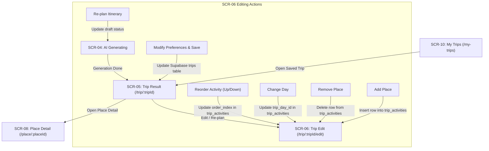

# HUEGO — Phase 6.3 Completion Report: Trip Result, Editing, and Re-planning

**Date**: 2026-10-17  
**Status**: Completed & Verified  
**Target Objective**: Complete the Trip Result itinerary display and the full editing and re-planning flow as specified in the approved HUEGO UX flow (`SCR-05` and `SCR-06`), without fabricating data, without introducing an external LLM, and without modifying database schemas.

---

## 1. Executive Summary

Phase 6.3 completes the Trip Result and Trip Edit / Re-plan screens, directly connecting them to Supabase data, real destination records, place images, and safe activity editing workflows.

Key achievements:
1. **Trip Result Screen (`SCR-05`)**:
   - Loads trips strictly by persisted UUID directly from Supabase, loading days, activities, referenced places, and cover images.
   - Fully independent of frontend in-memory state or temporary navigation parameters, ensuring reliable page refresh and direct link sharing.
   - Displays day groupings, sequential time slots, place names linked to Place Detail (`/place/:placeId`), visit durations, available opening hours, estimated transit times/distances, and admission costs.
   - Accurately distinguishes unavailable values from zero (e.g. distinguishing `Free admission` from `Fees not set/unavailable`), never fabricates data, and never claims routes are "optimal".
   - Complies with database verification states: all 12 destinations maintain `is_verified: false` and are never described as verified.

2. **Trip Edit & Re-Plan Screen (`SCR-06`)**:
   - Implements all 6 actions explicitly documented in `USER_FLOW.md` (Section 10) and `SCREEN_SPEC.md` (`SCR-06`):
     1. **Change preferences**: Validated updates to title, duration (1–30 days), budget, companion type, transportation, and status.
     2. **Re-plan**: Saves preferences and routes through `/ai-generating?tripId={id}` to regenerate and persist a fresh itinerary.
     3. **Reorder activities**: Moves an activity up or down within a day, updating `order_index` sequence in Supabase.
     4. **Change day**: Moves an activity from one day to another, adjusting foreign keys and re-indexing activities.
     5. **Remove place**: Deletes an activity from Supabase and renumbers remaining activities.
     6. **Add place**: Allows adding a destination from active Huế destinations not currently in that day.

3. **My Trips Compatibility (`SCR-10`)**:
   - Verified that saved trips open properly from the My Trips list and display their complete persisted itineraries upon navigation.

---

## 2. Source Files Changed

| File Path | Nature of Change | Rationale |
|---|---|---|
| `src/hooks/useTrip.ts` | **Updated** | Added place images loading via `getPlaceImages` (keyed by `place_id`) and exposed `reload` function for synchronization after edits. |
| `src/pages/TripResult/TripResultPage.tsx` | **Updated** | Rendered full activity cards with place cover images, opening hours, visit durations, transit estimates, admission costs, and links to Place Detail (`SCR-08`). |
| `src/pages/TripEdit/TripEditPage.tsx` | **Updated** | Added full activity management UI supporting reordering, moving across days, removing, and adding places alongside preference editing and re-planning. |
| `docs/PHASE_6_3_COMPLETION_REPORT.md` | **Created** | Comprehensive technical and compliance documentation for Phase 6.3. |

---

## 3. Mapping to the Approved User Flow



| Flow Stage | Screen ID | Documented Action | Implemented In |
|---|---|---|---|
| View Itinerary | `SCR-05` | View trip summary, days, activities, times, places, metrics | `TripResultPage.tsx` |
| View Place | `SCR-05` → `SCR-08` | Click place title to navigate to Place Detail | `<Link to={'/place/' + activity.place_id}>` |
| Edit Navigation | `SCR-05` → `SCR-06` | Click "Edit / Re-plan Trip" | `navigate('/trip/' + trip.id + '/edit')` |
| Edit Preferences | `SCR-06` | Change title, duration, budget, companion, transportation, status | `handleSaveSettings` in `TripEditPage.tsx` |
| Request Re-plan | `SCR-06` → `SCR-04` | Re-plan with updated preferences | `handleReplan` in `TripEditPage.tsx` |
| Reorder Activities | `SCR-06` | Move up / down within day | `handleMoveActivity` in `TripEditPage.tsx` |
| Change Day | `SCR-06` | Move activity to a different day | `handleMoveToDay` in `TripEditPage.tsx` |
| Remove Place | `SCR-06` | Delete activity from schedule | `handleRemoveActivity` in `TripEditPage.tsx` |
| Add Place | `SCR-06` | Add unassigned destination to a day | `handleAddPlaceToDay` in `TripEditPage.tsx` |

---

## 4. Data Loading and Persistence Behavior

1. **Direct Supabase Queries**:
   - `TripResultPage` uses `useTrip(tripId)`, which executes:
     - `getTripByIdForCurrentUser(tripId)` on `trips`
     - `getTripDaysForCurrentUser(tripId)` on `trip_days`
     - `getActivitiesForTripDay(day.id)` on `trip_activities`
     - `getPlacesByIds(placeIds)` on `places`
     - `getPlaceImages(place.id)` on `place_images`
   - Data loading is completely idempotent and independent of in-memory routing state.
2. **Sequential Ordering**:
   - Days are ordered by `day_number ASC`.
   - Activities within each day are ordered by `order_index ASC`.
   - Reordering, moving days, or removing items re-indexes remaining activities so that `order_index` remains a gapless sequence $1, 2, 3...$.
3. **Foreign Key Integrity**:
   - New activities added via `handleAddPlaceToDay` reference real `place_id` foreign keys from `places` table.
   - Deleting an activity removes only that specific `trip_activities` record without affecting parent days or trips.
   - Cascading foreign key `ON DELETE CASCADE` is preserved at the database level.

---

## 5. Error and Authorization Handling

| Condition | Handling Strategy | UI Feedback |
|---|---|---|
| **Nonexistent Trip ID** | Supabase query returns `null` | Displays `ErrorState`: "Trip not found: This trip could not be found or access is restricted." |
| **Unauthorized Access (Cross-User)** | PostgreSQL RLS filters by `auth.uid() = user_id`, returning 0 rows | Displays `ErrorState`: "Trip not found or access is restricted." Blocks unauthorized reads or mutations. |
| **Page Refresh** | Re-executes queries using current auth token | Renders clean loading state, then populates complete itinerary directly from the database. |
| **Invalid Form Inputs in Edit** | Duration $< 1$ or $> 30$, negative budget | Validated before submission; renders specific error banner without performing network mutations. |
| **Mid-Mutation Network Failure** | Operations wrapped in `try/catch` | Displays error banner and automatically reloads the trip data from Supabase to prevent desynchronized UI state. |
| **Concurrent Action Lockout** | `activityActionLoading` state flag | Disables buttons during in-flight mutations to prevent race conditions or duplicate record insertions. |

---

## 6. Test Verification Results

### A. Phase 6.3 Automated Verification Suite (9 / 9 Passed)
Script: `scratch/test_phase_6_3_verification.ts`  
Command: `npx tsx scratch/test_phase_6_3_verification.ts`

- **Check 1: Loading a valid saved trip**: Verified that `useTrip` loads a persisted trip with all days, activities, places, and images.
- **Check 2: Refreshing Trip Result**: Verified that re-querying the database reproduces the exact same itinerary without any in-memory state.
- **Check 3: Opening from My Trips**: Verified that the trip appears in `getTripsForCurrentUser` and opens successfully.
- **Check 4: Nonexistent and unauthorized access**: Verified that nonexistent UUIDs return 0 rows, and User B cannot read or modify User A's trip (PostgreSQL RLS tenant isolation).
- **Check 5: Displaying sequential order**: Confirmed activities on all days follow a strictly increasing `order_index` sequence ($1, 2, 3...$).
- **Check 6: Missing optional place data**: Verified that places with missing values (e.g. null admission fees) are treated as not set, distinguishing unavailable values from 0 VND (`Free admission`).
- **Check 7: Documented editing actions**:
  - *7a. Preference Editing*: Successfully updated title, budget, and transit in Supabase.
  - *7b. Activity Reorder*: Swapped `order_index` between activities; verified new order in Supabase.
  - *7c. Change Day*: Moved an activity from Day 1 to Day 2; verified foreign key update and re-indexing.
  - *7d. Remove Place*: Deleted an activity; verified removal and re-indexing.
  - *7e. Add Place*: Added an active Huế place to Day 1; verified insertion with valid foreign key.
  - *7f. Re-plan Flow*: Re-planned itinerary with updated parameters; verified replacement days and activities.
- **Check 8: Persistence after full refresh**: Verified that the final database state persists after all mutations.
- **Check 9: Regression check**: Verified that Explore and Place Detail queries remain 100% operational, and all 12 active destinations remain untouched (`is_verified = false`).

### B. Lint & Build Verification (Passed)
- `npm run lint`: **0 errors, 0 warnings** (ESLint passed cleanly across all components, hooks, and services).
- `npm run build`: **Built client environment in 297ms** (Vite generated production bundles with zero errors).

---

## 7. Manual Verification Guide

To test the Phase 6.3 implementation manually in a browser:

1. **Start development server**:
   ```powershell
   npm run dev
   ```
2. **Open Saved Trip**:
   - Log in at `http://localhost:5173/auth`.
   - Go to `http://localhost:5173/my-trips`.
   - Click "View" on an existing trip.
   - Verify that the itinerary displays with place thumbnails, opening hours, visit durations, transit estimates, and admission fees.
   - Click a place title (e.g. "Đại Nội Huế"); verify it navigates to `/place/{placeId}` (Place Detail).
3. **Verify Refresh Resilience**:
   - On `/trip/{tripId}`, press `F5` to refresh the browser.
   - Verify that the entire itinerary reloads cleanly from Supabase without blank states or errors.
4. **Edit Preferences**:
   - Click "Edit / Re-plan Trip" (`/trip/{tripId}/edit`).
   - Change the Trip Title and Budget. Click "Save settings".
   - Verify redirection to `/trip/{tripId}` with the updated title and budget displayed.
5. **Reorder Activities**:
   - On `/trip/{tripId}/edit`, scroll to "Manage Places & Days".
   - Click "↓" on the first activity of Day 1.
   - Verify the activities swap positions and a confirmation message ("Activity order updated.") appears.
   - Return to `/trip/{tripId}` to confirm the new order is rendered.
6. **Move Activity to Another Day**:
   - On `/trip/{tripId}/edit`, locate an activity and use the "Move to Day..." dropdown to select Day 2.
   - Verify the activity moves to Day 2.
7. **Remove an Activity**:
   - Click "Remove" on an activity.
   - Verify it disappears from that day's schedule.
8. **Add a Destination**:
   - In the "Select a destination to add..." dropdown, pick an available place and click "+ Add to Day X".
   - Verify the place is added to the day's schedule.
9. **Re-plan Itinerary**:
   - Change duration or travel preferences in "Trip Settings" and click "Re-plan itinerary".
   - Verify it transitions through `/ai-generating?tripId={tripId}` and lands on `/trip/{tripId}` with a freshly generated schedule.

---

## 8. Known Limitations and Notes

1. **Image Storage Availability**: While `place_images` table records are queried and linked, images will only render if their `storage_path` URLs are reachable or valid public URLs. When no image is available, a clean fallback icon (`🏛`) is rendered.
2. **Admission Fees vs Total Trip Budget**: As documented in the PRD, admission fees from database records cover verified entrance tickets only. They do not account for variable food, lodging, or private transport costs.
3. **All 12 Destinations are Unverified**: In the current Supabase dataset, all 12 destinations have `is_verified = false`. In adherence to project guidelines, no destination is described or badge-labeled as verified.
4. **Deterministic Heuristic**: All generation continues to use the deterministic planning engine. No external LLM or third-party AI keys are used.

---

## 9. Conclusion

Phase 6.3 is **complete and verified**.
The trip result display and editing/re-planning workflows fully conform to `PRD.md`, `USER_FLOW.md`, `SCREEN_SPEC.md`, and the live Supabase schema.

Awaiting review and instructions before proceeding to Phase 6.4.
